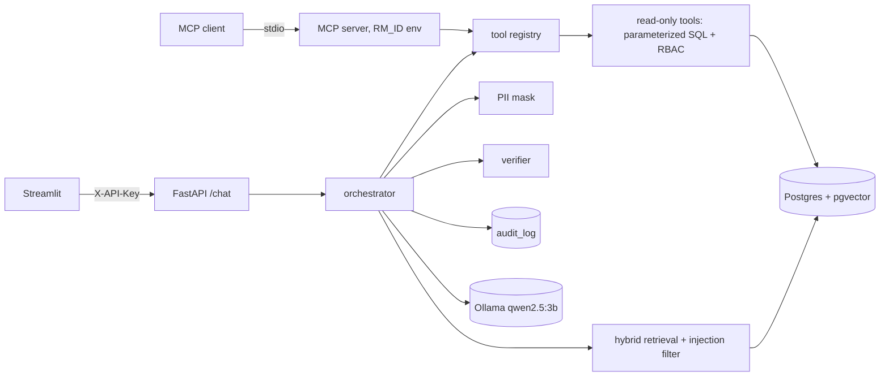

# Banking Operations Copilot

LLM assistant for bank staff comparing RAG, function calling, and MCP on the same banking use cases, with
PII masking, role-based access, and a grounding verifier. Runs fully local (Ollama + Postgres/pgvector).

[Eval report](eval/reports/results.md) · [Architecture](docs/architecture.md) · [Design decisions](docs/decisions.md) · [Request walkthrough](docs/walkthrough.md)

## Use cases

| | Question | Approach |
|---|---|---|
| UC1 | "How many overdraft fee waivers can a customer get per year?" | **RAG** over 8 policy documents, answers cite `[doc §section]` or refuse |
| UC2 | "Which SME loans in my portfolio are more than 30 days past due, and what's the exposure?" | **Function calling** over typed, read-only tools with RBAC |
| UC3 | "Why was transaction T004015 flagged and which policy applies?" | **Tools + RAG**, also exposed to any client through an **MCP** server |

Details: [docs/requirements.md](docs/requirements.md).

## Architecture



Hand-written orchestration (no LangChain/LlamaIndex): four modes (`prompt_only`, `rag`, `tools`,
`tools_rag`), a tool loop capped at 5 calls, and a verifier that always measures and optionally rewrites.
Full flow: [docs/architecture.md](docs/architecture.md).

## Results

40-question golden set (12 policy, 12 data, 8 combined, 8 should-refuse) · model: `qwen2.5:3b` (Ollama, 8k
context) · embeddings: `nomic-embed-text` · MacBook Air M1 8 GB · 2026-10-27 · full report:
[eval/reports/results.md](eval/reports/results.md)

| Config | Answer acc. | Citation acc. | Unsupported claims | Correct refusals | p95 latency |
|---|---|---|---|---|---|
| prompt_only | 0% | 0% | 0% | 100% | 0.7s |
| rag | 41% | 75% | 0% | 100% | 5.1s |
| tools | 44% | 0% | 16% | 100% | 36.6s |
| tools_rag | **69%** | 50% | 34% | 100% | 46.1s |
| tools_rag + verify | 66% | 40% | **0%** | 100% | 48.9s |
| mcp (tools_rag + verify over MCP) | 59% | 25% | 0% | 100% | 42.0s |

Answer accuracy is over the 32 answerable questions; by type, RAG answers 12/12 policy questions, the tool
configs 9/12 data questions, and tools_rag 5/8 combined questions. No config leaked another RM's data.

## Findings

Each approach wins its own question type, and only the combination covers all three. RAG answered all 12
policy questions with the correct citation in under 4 s, but cannot answer data questions. Function calling
answered 9/12 data questions, but without a policy tool it gets only 1/12 policy questions. tools_rag is the best
overall config (69% of answerable questions), because it is the only one that handles combined questions
("why was T flagged and which policy applies") reasonably (5/8).

Before verification, 34% of tools_rag answers contained at least one number, date or citation that was not in the
tool results or retrieved text. The verifier removed all of them, at a cost of one combined question (69% → 66%).
Of the 11 answers it edited, 6 removals were real errors ("80%" where the policy says 8%, "every 6 months" where
it says monthly, invented tier breakdowns, fabricated `[§01]` / `[§12]` citations), 4 removed harmless filler with
a self-counted number ("here are the first 5 loans"), and 1 removed a true fact that shared a sentence with a
fabricated citation.

The most surprising result: the remaining data errors are *grounded but wrong*. The 3B model added filters nobody
asked for (`segment=retail, risk_tier=A` for "my mortgage exposure") or swapped customer C0166 for transaction
T000166. Its numbers then match the tool output exactly, so the verifier can't catch them: grounding is not the
same as correctness. Access control, by contrast, was perfect in every config (8/8 refusals, 0 leaks), because
it never depended on the model.

In tool mode the small model rarely cites (tools_rag cites the right document for 50% of policy and combined
questions, RAG for 100% of policy questions), and sometimes answers a policy question without calling
`search_policies`. MCP gave identical tool results (verified in tests), but end to end it scored 2 questions
lower than in-process function calling: shown FastMCP's more verbose schemas, the model twice declined to call
any tool. That is within noise at this sample size, but it suggests schema format matters for small models.

While analysing the run I found a grader bug (a key fact matched "6 months" for "monthly"). It was fixed and the
stored answers were re-graded with `run_eval.py --rescore`, without re-running the model. One refusal-metric
leniency remains: in tool modes the model refused the pancake question and then added a recipe anyway, which
still counts as a refusal.

## Security & governance

- **RBAC in code, not in the prompt.** The RM comes from the API key (or the MCP server's `RM_ID`). Tool schemas
  have no `rm_id`, extra arguments are rejected, every query filters by the server-side RM, and foreign and
  missing IDs give the same `access_denied`. Tested with a scripted *hostile* LLM.
- **The LLM never writes SQL.** Five typed read-only tools with Pydantic inputs/outputs and parameterized SQL.
- **PII masking.** IBAN, email and phone are masked in the question, in tool outputs before they reach the model,
  and in the audit log (tested on 1,000 Faker phone numbers plus negative cases for amounts, dates and IDs).
- **Prompt-injection filter** on retrieved chunks (with a poisoned test policy), and policy text is framed as data.
- **Grounding verifier.** Numbers, dates and citations must be backed by the evidence; a cited sentence must be
  backed by *the chunk it cites*. Unsupported sentences are removed and flagged.
- **Audit log**: one masked row per request, fail-closed.
- **Deterministic refusals** for weak retrieval and denied access.

## Run it

Prerequisites: Docker (OrbStack/Docker Desktop), [Ollama](https://ollama.com), [uv](https://docs.astral.sh/uv/), Python 3.11.

```bash
ollama pull qwen2.5:3b && ollama pull nomic-embed-text
ollama create copilot-qwen -f ollama/Modelfile   # 8k context; the default silently truncates prompts
uv sync
docker compose up -d --build                     # db, api (:8000), ui (:8501)
uv run python data/generate_synthetic.py         # 1,000 customers, 1,500 loans, 50,000 transactions
uv run python -m app.rag.ingest                  # chunk + embed the 8 policies
open http://localhost:8501
```

Tests and evaluation:

```bash
uv run ruff check . && uv run pytest -q          # uses an isolated <db>_test database and MockLLM
uv run python eval/run_eval.py --mock --limit 10 # pipeline check without a model (what CI runs)
uv run python eval/run_eval.py                   # full eval on the local model (~40 min, resumable: --resume)
```

MCP (Claude Desktop / Cursor / Inspector), see `mcp_server/server.py`:

```bash
npx @modelcontextprotocol/inspector -e RM_ID=RM-1 uv run --directory "$PWD" python -m mcp_server.server
```

```json
{"mcpServers": {"banking-copilot": {"command": "uv",
  "args": ["run", "--directory", "/path/to/repo", "python", "-m", "mcp_server.server"],
  "env": {"RM_ID": "RM-1"}}}}
```

Switching to OpenAI / Azure OpenAI only needs env vars (`LLM_BASE_URL`, `LLM_API_KEY`, `LLM_MODEL`, and
`EMBED_MODEL` + re-ingest), see `.env.example`.

## Design decisions → [docs/decisions.md](docs/decisions.md)

## Limitations

- **Synthetic data and fictional policies.** Real policies are longer, overlap, and change over time.
- **Small eval set.** 40 questions; one percentage point is less than half a question per category, so small
  differences between configs are noise.
- **Small local model.** `qwen2.5:3b` on an 8 GB laptop: weaker tool selection and citation discipline than a
  hosted model; numbers would change with another model.
- **Regex PII masking.** Covers IBAN, email and German/international phone formats only; names and addresses
  are not masked.
- **Heuristic injection filter.** Pattern-based; paraphrased attacks will get through (the prompt framing and
  read-only tools limit the damage).
- **Verifier limits.** Numbers in words and model-derived values aren't verified as such; a small number can
  be "supported" by accident in a large tool result.
- **Demo authentication.** Static API keys stand in for SSO.
