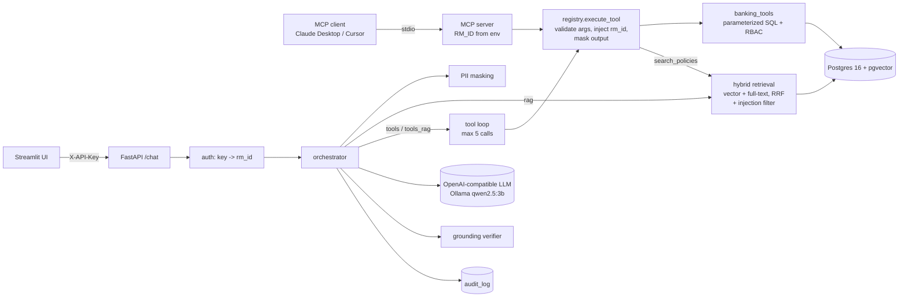

# Architecture

## Request flow (`POST /chat`, mode `tools_rag`, verify on)

1. **Auth** (`app/auth.py`): the `X-API-Key` header is mapped to an `rm_id`. The JSON body has no `rm_id`
   field (`extra="forbid"`), so a client cannot choose its RM.
2. **Mask** (`app/guardrails/pii.py`): IBAN, email and phone in the question become `[IBAN]`, `[EMAIL]`, `[PHONE]`.
3. **Tool loop** (`app/orchestrator.py`): system prompt with a tool guide and examples, plus the tool schemas
   (generated from Pydantic argument models, without `rm_id`). Up to 5 tool calls, then a forced final answer.
   Tool calls written as text by small models are parsed; argument errors go back to the model as data.
4. **Execute** (`app/tools/registry.py`): validate arguments (`extra="forbid"`, ID normalisation), call the tool
   with the server-side `rm_id`, mask PII in the result, return JSON. `search_policies` runs hybrid retrieval.
5. **Tools** (`app/tools/banking_tools.py`): parameterized SQL filtered by `customers.rm_id`. A foreign and a
   missing ID give the same `access_denied`. Lists return `count` + totals + top 20 rows.
6. **Access denied**: if every data tool call was denied, the answer is a fixed message, not model text.
7. **Verify** (`app/verifier.py`): every number, date and citation must appear in the tool results / cited
   chunks / question. Unsupported sentences are removed and the answer is marked unverified.
8. **Audit** (`app/audit.py`): one row, masked; fail-closed.

## Retrieval (`app/rag/`)

- **Ingest**: one chunk per `##` section of each policy (40 chunks), embedded with `nomic-embed-text`
  (`search_document:` prefix). The embedding model name is stored with each chunk; retrieval refuses to
  query with a different model.
- **Retrieve**: top-5 by cosine similarity + top-5 by `ts_rank` over an OR-query of stemmed lexemes, merged
  with reciprocal-rank fusion (`1/(60+rank)`), then chunks that look like prompt injection are dropped.
- **Gate**: retrieval is "strong" if top cosine ≥ 0.60, or ≥ 0.53 with a keyword hit (`ts_rank` ≥ 0.025).
  Otherwise RAG answers "I don't have a policy source for that." without calling the LLM.
- **Prompt format**: every rule line ends with its source tag, so a small model that copies a rule copies the
  right citation.

## Data model

`relationship_managers` (5) → `customers` (1,000, round-robin over RMs) → `loans` (1,500, 12% > 30 DPD) and
`transactions` (50,000, 1% flagged by AML-01/02/03, and the flagged rows really satisfy their rule).
`policy_chunks` (vector(768) + generated `tsvector`), `audit_log`.

## Deployment

`docker compose up` starts `db` (pgvector), `api` (uvicorn) and `ui` (Streamlit) from one image. Ollama runs
on the host (containers on macOS have no GPU access) and is reached via `host.docker.internal`.
